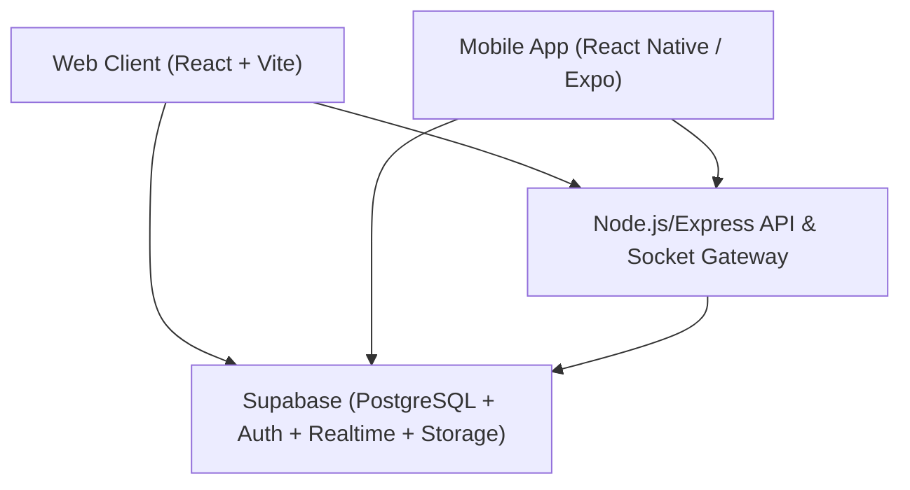

# System Architecture Overview

GroupSync is structured as an enterprise monorepo with clean separation between frontend, backend, database, and client applications.

## High-Level Topology

## Monorepo Layout
- `frontend/`: React 19 + Vite 7 application styled with Tailwind CSS, Framer Motion, and Lucide icons.
- `backend/`: Express.js REST API and Socket.IO real-time microservice.
- `database/`: Supabase PostgreSQL migrations, seeds, RLS policies, DB functions, and triggers.
- `mobile/`: React Native / Expo cross-platform mobile client.
- `docs/`: Centralized engineering and design documentation.
